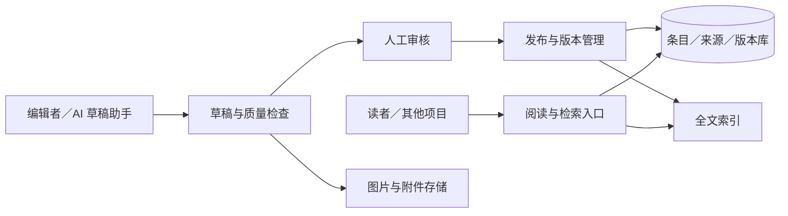

# jdp-wiki 开发规划

更新：2026-10-13。阶段与架构为建议，尚未选定技术栈，不承诺未经验证的日期或能力。

## 阶段与交付门槛

| 阶段 | 交付 | 完成标准 |
| --- | --- | --- |
| M0 样本与选型 | 20～30 条样本、字段模板、公共／私有概念分类；评估既有实验资产 | 独有资料保留；选定条目 ID、发布方式、技术栈及软件／内容许可方案 |
| M1 阅读检索 | 条目页、分类、别名、消歧、相关条目、全文检索；两项目通用术语迁移试点 | 中文、缩写和同名异义样本能找到正确条目；来源可查、移动端可读 |
| M2 内容维护（首版完成） | 草稿、审核、发布、版本、撤回、纠错、权限与备份 | 需求中的维护闭环通过验收；未公开内容无公共入口；恢复演练成功 |
| M3 跨项目复用与协作 | 扩大术语复用、稳定引用治理、可信贡献者、按需 API／RAG | 至少两个项目复用同一公共条目；私有概念仍在原项目；引用与授权可追溯 |

M 表示 Milestone（里程碑）；是交付节点，不是独立服务或工程数量。首版截止 M2，M3 按实际需要安排。

首批条目来源和迁移边界见 [跨项目术语迁入候选清单](content-candidates.md)；候选尚未成为正式条目。

## 架构建议

先做一个可部署应用，按阅读检索、内容维护、权限和存储划分模块；无需为了分工立即拆成微服务。

关系库保存条目、别名、分类、关联、来源、版本、审核和反馈。原型可用 SQLite，多人服务可评估 PostgreSQL；中文全文检索必须实测。附件独立保存，向量库和图数据库按后续场景决定。

比较 MediaWiki 的成熟协作能力与自建 Markdown 产品的体验、API 和维护成本，再决定方案。既有 raw/、wiki/、schema.md 是实验资产，迁移需逐项映射，不能直接作为已发布内容。

## 实施顺序

1. 确定样本、读者、模板、稳定 ID 与公开范围，盘点实验结构及云端生态资料。
2. 建立阅读检索原型，验证中文搜索和示例质量。
3. 打通编辑发布与版本，验证撤回、权限、备份恢复。
4. 在 M1 先准备两项目术语迁移试点，条目发布后替换外链；M3 扩大复用和协作、API、RAG，不以条目数量替代质量。

正文只显示当前正式内容，版本追溯单独呈现，避免重复“原始记录／历史版本”正文。事实变更更新来源与核验日期，个人原有表达和独有资产不能在迁移中丢失。

## GitHub 关联与发布

本地已关联 https://github.com/lixudong1649/jdp-wiki，沿用现有 main 历史。云端原有生态文件、图片和 Agent 探索介绍保留。本地目录与远端名称统一为 jdp-wiki（原远端名 jdpWiki），沿用小写中划线命名约定。公开提交需先审查变更、隐私和授权；提交规划不代表网站功能已完成。Pages 路径随改名变为 /jdp-wiki/，旧网站地址不自动重定向。

实验会话、原始导入资料和编辑器状态默认不进入版本库；经筛选的公开条目可单独纳入。每项实验记录目的、依赖、运行方式、结果与限制，计划与验证结果明确区分。

## 当前进度

已建立 88 个独立通用术语条目，静态检索由 Markdown 正文生成，支持名称／别名／正文关键词和分类。6 个项目采用外链复用，专属说明留原项目。见 [检索页面](term-search.md)、[迁移方案](term-migration.md)。M1 的进一步消歧体验和 M2 的内容维护后台尚未完成。
