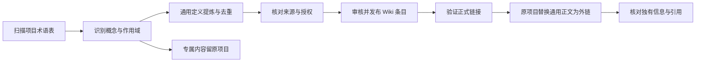

# 跨项目通用术语迁移

更新：2026-10-13。规则与实施方案；首批范围见 [候选清单](content-candidates.md)。本次已建立 88 个独立通用条目，检索数据由唯一 Markdown 正文生成。原项目按验证可用的公开链接引用，混合说明保留专属部分。

## 唯一主位置

**通用概念的定义、解释、例子和来源由 jdp-wiki 维护；原项目术语表只保留外链和本项目特有的含义、实现与约束。** “项目私有”指项目专属语义，不一定是保密信息；公开项目里的专属约定也应留在该项目。

| 内容 | 处理 |
| --- | --- |
| MCP、RAG、幂等性等跨项目概念 | 提炼至 Wiki，同义名称作为别名，不重复建条目 |
| 通用概念＋本项目实现的混合说明 | 仅迁通用部分；项目保留实现、参数和使用条件 |
| 专属字段、内部阶段、业务规则、服务配置 | 原项目维护，可引用相关通用概念 |
| 同名异义，例如 TTL、Token | 按语义拆条目并消歧，不按名称强行合并 |
| 来源、含义或公开授权不明 | 保留原处，标待确认，沟通后处理 |

## 迁移流程



1. 逐段记录来源、候选概念、迁入部分、保留部分和待确认原因。映射记录留在本地知识库，不将私人绝对路径、配置或会话资料放入公开条目。
2. 同概念合并唯一 ID，例如 `mcp`；同名不同义分开。先比对各项目定义的条件、区别和独有例子，再编写正文，不能只按关键词删除。
3. 根据官方规范、文档和论文独立核验，保留独有知识及必要来源；原始资料有再利用限制时不直接复制。
4. 先发布条目并验证链接，再修改原项目；按两项目小批试点扩展。每个项目变更范围可审阅，禁止盲目批量清空术语表。
5. 原项目只移除已迁且无专属意义的重复通用正文。明确无法公开的内容不进入公共数据、索引或构建产物。

## 原项目引用示例

正式发布后，项目术语表可写：

```markdown
| 术语 | 通用定义 | 本项目约定 |
| --- | --- | --- |
| MCP | [模型上下文协议](https://github.com/lixudong1649/jdp-wiki/blob/main/content/terms/mcp.md) | 只开放订单只读工具，配置见本项目工具文档 |
```

原项目优先引用可直接阅读的 GitHub Markdown 条目；检索网站通过 `#稳定ID` 定位同一概念。纯通用术语不再复制一句定义，无项目约定时省略约定列。

稳定 ID 不随标题更名变化；改 ID 需要旧 ID 映射或重定向。一般引用当前条目，需要固定验收口径时引用固定提交／版本。原型只有锚点，没有历史版本和重定向能力。

## 验收

- 每个已迁概念都有唯一 ID、准确作用域、定义、例子、边界、来源与核验日期。
- 迁入内容与保留内容可逐项对照；独有知识、项目条件和私有概念未丢失。
- 正式链接实际可访问且定位对应条目；至少两个项目引用同一概念。
- 原项目不重复维护已迁通用正文；目录、链接和名称同步检查。
- 待确认项保留原处；正式迁移、示例、草稿和已发布状态明确区分。
